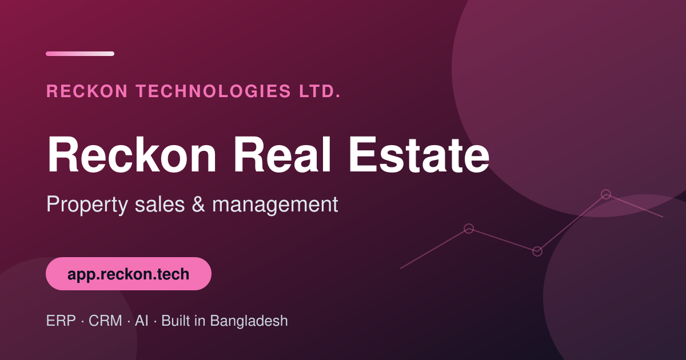

# Real Estate ERP on ERPNext: Bookings, Installments, BOQ and Project Profitability

Property developers in Bangladesh juggle unit sales, long installment schedules, contractor bills and project budgets, often across separate spreadsheets. **Reckon Real Estate** is a real estate vertical built by Reckon Technologies Ltd. on ERPNext to keep the whole property lifecycle, from land and units to handover and project profit, in one ERP.

## Detailed features

### Projects, land and units
- Real estate projects, buildings, floors and saleable units with status and availability.
- Land parcels, land owners, joint-venture agreements and allocations.

### Bookings, installments and collections
- Property bookings with installment plans and schedules (down payment, monthly, milestone and other plans).
- Collection entries with payment allocation and a unit-wise customer property ledger.
- Overdue and unit availability reports.

### Construction costing and control
- BOQ with amendment and version history.
- Project budgets with budget vs actual, using posted accounting plus open purchase commitments.
- Contractors, contractor work orders, quantity-certified measurement sheets and retention-aware running bills.
- Construction cost forecast and an executive dashboard.

### Sales performance
- Sales targets and booking commission accruals.

### After-sales
- Handover, snags, warranty, service requests and maintenance.

### Built on ERPNext accounting
- ERPNext stays the source of truth for receivables, payables, stock, payments and the general ledger.
- Installment plans create linked sales invoices, collection entries create payment entries, BOQs create material requests and work orders create stock issues.
- Running bills create purchase invoices, so property ledgers and project profitability read from posted accounting data.
- Works with ERPNext and Frappe versions 15 and 16.

## Who it is for
- Real estate developers and apartment or land developers.
- Commercial property and housing project companies.
- Real estate sales and marketing teams, and property management organisations.

## Try ReckonERP

Reckon Technologies builds ReckonERP: ERP, CRM and AI agents for growing businesses, with accounting, distribution management and HRMS in Bangla and English. Start at [app.reckon.tech](https://app.reckon.tech) or create an account at [app.reckon.tech/reckonerp-signup](https://app.reckon.tech/reckonerp-signup).

## Related reading
- [ERP software in Bangladesh: buyer's guide](https://app.reckon.tech/blog/erp-software-in-bangladesh-buyers-guide)
- [How to choose an ERP provider in Bangladesh](https://app.reckon.tech/blog/how-to-choose-an-erp-provider-in-bangladesh)
- [ERP implementation cost in Bangladesh](https://app.reckon.tech/blog/erp-implementation-cost-in-bangladesh)
- [Reckon on Hashnode](https://reckonerp.hashnode.dev) and [Reckon on LinkedIn](https://bd.linkedin.com/company/reckontech)

## Reckon Technologies Ltd. — ERP, CRM and AI Provider in Bangladesh

### Company highlights
- ERP, CRM and AI agents under one platform, ReckonERP.
- Built for Bangladeshi businesses: BDT, local compliance, Bangla and English.
- AI-assisted guided implementation with Ask Aura.
- Modules for accounts (ReckonBooks), HR and payroll, distribution, sales and more.
- Custom AI agent development and an AI sales agent.
- Based in Dhaka, serving customers across Bangladesh.

More at [reckon.tech](https://www.reckon.tech) · [app.reckon.tech](https://app.reckon.tech) · [All Reckon products](https://techwithzakir.github.io/)

*Topics: real estate ERP, ERPNext, installments, BOQ, project profitability, property developers, Bangladesh, AI agents*
